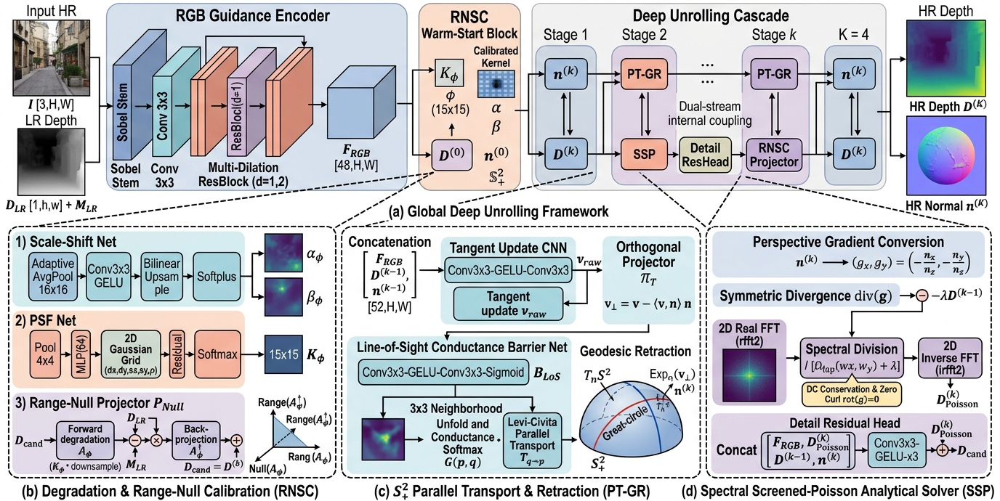

# RiemannGDSR: Spectral Screened-Poisson $\mathbb{S}^2_+$ Surface-Normal Geodesic Unrolling for Guided Depth Map Super-Resolution

**Authors:** Tongquan Wu, Yuanxu Wang, Lu Bai, Xu Liu, and Yurong Qian* (*Corresponding author)  
**Repository:** [https://github.com/Morjay-Wu/RiemannGDSR.git](https://github.com/Morjay-Wu/RiemannGDSR.git)  
**Funding:** Supported by National Natural Science Foundation of China (62266043) — *"Key Technologies of Space-Air-Ground Multi-Modal Data Fusion for Digital Twin Agriculture"*.

---

## Overview

<p align="center">
  
</p>

**RiemannGDSR** is a physics- and geometry-grounded deep algorithm unrolling network for **Guided Depth Map Super-Resolution (GDSR)** formulated on the Riemannian manifold of unit surface normals $\mathbb{S}^2_+ = \{ \mathbf{n} \in \mathbb{R}^3 \mid \|\mathbf{n}\|_2 = 1, \ n_z > 0 \}$.

### Key Contributions
1. **Range-Null Self-Calibration (`RNSC`)**: Explicitly estimates a $15 \times 15$ anisotropic sensor Point Spread Function (PSF) kernel $K_\phi$ ($\sum K_\phi \equiv 1$) and coarse-to-fine scale-shift fields $(\alpha_\phi, \beta_\phi)$ initialized as an exact identity mapping at epoch 0. Enforces hard sensor measurement consistency via an analytical right-inverse $\mathcal{A}_\phi^\dagger$ and orthogonal range-null space projector $\mathcal{P}_{\text{Null}}$.
2. **Conductance-Insulated $\mathbb{S}^2_+$ Parallel Transport & Geodesic Retraction (`PT-GR`)**: Projects neural updates onto the local tangent space $T_{\mathbf{n}}\mathbb{S}^2$, aggregates $3 \times 3$ neighbors via closed-form Levi-Civita parallel transport insulated by a learned Line-of-Sight (LoS) barrier $B_{\text{LoS}}$, and maps updates back onto $\mathbb{S}^2_+$ via the closed-form geodesic exponential retraction $\operatorname{Exp}_{\mathbf{n}}(\mathbf{v}_\perp)$.
3. **Spectral Screened-Poisson Analytical Solver (`SSP`)**: Integrates perspective depth gradients in the 2D real Fast Fourier Transform (`rfft2`) domain in closed form with $\mathcal{O}(HW \log(HW))$ complexity, guaranteeing exact zero curl ($\nabla \times \nabla D \equiv 0$) and zero-frequency (DC) depth conservation ($\widehat{D}(0,0) \equiv \widehat{D}_{\text{anchor}}(0,0)$).
4. **Lightweight Efficiency**: Only **1.58M** parameters, **34.2 FPS** inference on $480 \times 640$ RGB-D pairs (RTX 3090), and strictly **1.494 GB** peak GPU training memory.

---

## Repository Structure

```text
RiemannGDSR/
├── assets/                                  # Overview & qualitative figures
│   ├── arch_overview.jpg                    # 4-in-1 model architecture diagram
│   ├── s2_geodesic_teaser.jpg               # S2+ geodesic transport & LoS insulation teaser
│   ├── qualitative_sota_x8.png              # Visual comparisons across 4 benchmarks (x8)
│   └── unrolling_evolution.png              # K=4 geodesic unrolling trajectory visualization
├── riemann_gdsr/
│   ├── models/
│   │   ├── riemann_gdsr.py                  # Main RiemannGDSR K-stage unrolling network
│   │   ├── sensor_calibration.py            # Range-Null Self-Calibration (RNSC) & PSF module
│   │   ├── tangent_transport.py             # LoS Conductance-Insulated Parallel Transport
│   │   ├── geodesic_retraction.py           # Closed-form S2+ Geodesic Exponential Retraction
│   │   └── screened_poisson_solver.py       # 2D FFT Spectral Screened-Poisson (SSP) Solver
│   ├── datasets/
│   │   ├── base_gdsr.py                     # Unified dataset base & physical sensor degradation
│   │   ├── nyuv2.py                         # NYUv2 dataset loader
│   │   ├── middlebury.py                    # Middlebury & Lu dataset loaders
│   │   └── rgbdd.py                         # RGB-D-D (Synthetic & Real-World ToF) loader
│   ├── losses/
│   │   └── gdsr_loss.py                     # Multi-stage L1 + S2+ geodesic + gradient loss
│   ├── tests/
│   │   └── test_riemann_gdsr.py             # Mathematical invariant & VRAM unit tests
│   ├── metrics.py                           # RMSE (cm), MAE (cm), AbsRel, delta_1 metrics
│   ├── sota_models.py                       # Classical & deep SOTA comparison baselines
│   ├── train.py                             # Training entry script
│   ├── eval.py                              # Single-model evaluation script
│   └── eval_sota.py                         # Multi-scale SOTA benchmark evaluation suite
├── scripts/
│   └── prepare_general_cv_data.py           # Benchmark dataset preparation & verification
├── requirements.txt
└── LICENSE
```

---

## Installation

```bash
git clone https://github.com/Morjay-Wu/RiemannGDSR.git
cd RiemannGDSR
conda create -n pytorch python=3.10 -y
conda activate pytorch
pip install -r requirements.txt
```

---

## Quick Verification & Mathematical Unit Tests

Run the built-in unit test suite to verify all mathematical invariants (exact unit-norm surface normals $\|\mathbf{n}^{(k)}\|_2 \equiv 1$, positive hemisphere visibility $n_z^{(k)} > 0$, tangent orthogonality $\langle \mathbf{n}, \mathbf{v}_\perp \rangle \equiv 0$, PSF partition-of-unity $\sum K_\phi \equiv 1$, Screened-Poisson zero DC drift, and $<1.5\text{ GB}$ peak GPU training memory):

```bash
conda activate pytorch
python -m riemann_gdsr.tests.test_riemann_gdsr
```

---

## Dataset Preparation

Organize the four standard RGB-D benchmarks (`NYUv2`, `Middlebury`, `Lu`, and `RGB-D-D`) under `./data/gdsr/`:

```text
data/gdsr/
├── nyuv2/            # 1,000 train + 449 test RGB-D pairs (480x640)
├── middlebury/       # 30 high-precision structured-light indoor scenes
├── lu/               # 6 challenging occlusion RGB-D pairs
└── rgbdd/            # Synthetic & Real-World ToF RGB-D-D benchmark
```

You can verify or prepare the dataset splits using:
```bash
python scripts/prepare_general_cv_data.py --data_root ./data/gdsr
```

---

## Training & Evaluation

### 1. Train RiemannGDSR
```bash
# Train on NYUv2 (x8 scaling factor, K=4 unrolling stages, C=48 channels)
python -m riemann_gdsr.train \
    --dataset nyuv2 \
    --data_root ./data/gdsr \
    --scale 8 \
    --epochs 80 \
    --batch_size 4 \
    --lr 3e-4 \
    --num_stages 4 \
    --feat_channels 48 \
    --save_dir ./runs/riemann_gdsr_nyuv2_x8
```

### 2. Evaluate on NYUv2, Middlebury, Lu, and RGB-D-D
```bash
# Evaluate a trained checkpoint on any benchmark and scale (x4, x8, x16)
python -m riemann_gdsr.eval \
    --dataset nyuv2 \
    --data_root ./data/gdsr \
    --scale 8 \
    --checkpoint ./runs/riemann_gdsr_nyuv2_x8/best.pt

# Run the comprehensive multi-scale SOTA benchmark suite
python -m riemann_gdsr.eval_sota \
    --data_root ./data/gdsr \
    --scales 4 8 16 \
    --ckpt_ours ./runs/riemann_gdsr_nyuv2_x8/best.pt
```

---

## Quantitative Results (RMSE in cm $\downarrow$)

| Method | Publication | NYUv2 ($\times 4 / \times 8 / \times 16$) | Middlebury ($\times 4 / \times 8 / \times 16$) | Lu ($\times 4 / \times 8 / \times 16$) | RGB-D-D ($\times 4 / \times 8 / \times 16$) |
| :--- | :---: | :---: | :---: | :---: | :---: |
| Bicubic | -- | 4.74 / 7.91 / 12.83 | 9.57 / 14.90 / 22.43 | 9.53 / 18.14 / 29.73 | 2.07 / 3.15 / 4.92 |
| JBU | SIGGRAPH'07 | 4.31 / 7.34 / 12.55 | 9.41 / 14.15 / 21.98 | 12.10 / 18.51 / 29.65 | 2.25 / 3.11 / 4.86 |
| FDSR | CVPR'21 | 2.88 / 5.08 / 8.96 | 7.76 / 12.45 / 19.10 | 7.48 / 14.85 / 25.95 | 1.91 / 2.84 / 4.41 |
| DADA | CVPR'23 | 2.61 / 6.97 / 11.87 | 7.11 / 13.98 / 21.16 | 5.65 / 16.30 / 27.79 | 1.89 / 2.96 / 4.63 |
| SGNet | AAAI'24 | 2.87 / 6.09 / 11.85 | 7.12 / 13.23 / 22.38 | 5.19 / 15.08 / 28.41 | 1.71 / 3.18 / 5.36 |
| DORNet | CVPR'25 | **1.41** / 4.68 / **7.13** | **6.55** / 11.60 / **17.45** | **4.87** / **13.11** / **23.27** | **1.67** / 2.60 / **3.66** |
| DuCos | ICCV'25 | 2.79 / 6.31 / 10.89 | 7.17 / 13.08 / 20.89 | 5.17 / 15.88 / 27.29 | 1.71 / 3.05 / 4.75 |
| **RiemannGDSR (Ours)** | -- | 2.30 / **4.12** / 7.61 | 7.32 / **10.61** / 17.54 | 6.34 / 13.17 / 25.77 | 1.77 / **2.50** / 3.93 |

---

## Citation

```bibtex
@inproceedings{wu2026riemanngdsr,
  title     = {RiemannGDSR: Spectral Screened-Poisson $\mathbb{S}^2_+$ Surface-Normal Geodesic Unrolling for Guided Depth Map Super-Resolution},
  author    = {Wu, Tongquan and Wang, Yuanxu and Bai, Lu and Liu, Xu and Qian, Yurong},
  booktitle = {Proceedings of the IEEE/CVF Conference on Computer Vision and Pattern Recognition (CVPR)},
  year      = {2026}
}
```

## Acknowledgments
Supported by National Natural Science Foundation of China (62266043) — *"Key Technologies of Space-Air-Ground Multi-Modal Data Fusion for Digital Twin Agriculture"*（国家自然科学基金项目“面向数字孪生农业的空-天-地多模态数据融合关键技术研究”，62266043）.
